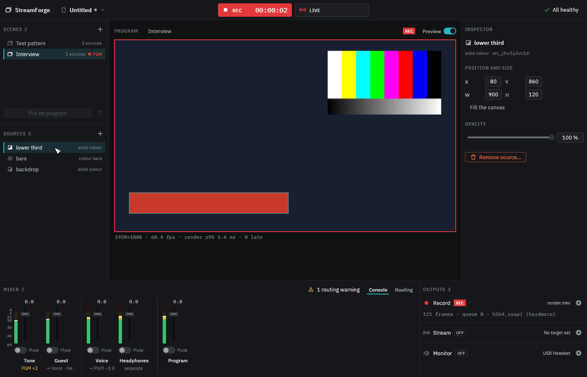

# StreamForge user guide

StreamForge composes scenes, mixes audio, and records and streams the result. You run it from the desktop app, the command line, scripts (JSON lines over stdin and stdout), or an AI agent over MCP. All four use the same commands and the same engine code. Each program runs its own engine, though: they do not share scenes or outputs, and one does not see what another records.

This guide is for version 0.1.0 on Linux. [Known limitations](#known-limitations) lists what it does not do yet.

- [Install](#install)
- [Desktop app](#desktop-app)
- [Command line](#command-line)
- [Scripting the engine](#scripting-the-engine)
- [AI agents (MCP)](#ai-agents-mcp)
- [Files and folders](#files-and-folders)
- [Troubleshooting](#troubleshooting)
- [Known limitations](#known-limitations)
- [Licences](#licences)

## Install

### From a release package

Packages are built for **Ubuntu 24.04** and **Arch Linux** (x86_64). They use the system's FFmpeg and PipeWire libraries, so take the package for your distribution; on any other, [build from source](#from-source).

1. Install the runtime dependencies:

   ```sh
   # Ubuntu 24.04
   sudo apt install ffmpeg pipewire xdg-desktop-portal
   # Arch Linux
   sudo pacman -S --needed ffmpeg pipewire xdg-desktop-portal
   ```

   Screen capture also needs the portal backend of your desktop: `xdg-desktop-portal-gnome`, `-kde`, `-wlr`, `-hyprland` and so on. Most desktops install it already.

2. Download `streamforge-<version>-x86_64-linux-<distro>.tar.gz` and its `.sha256` file from the [releases page](https://github.com/lnkzw/streamforge/releases), then check, unpack and install it:

   ```sh
   sha256sum -c streamforge-*.tar.gz.sha256
   tar -xzf streamforge-*.tar.gz
   cd streamforge-*/
   ./install.sh
   ```

   `install.sh` copies the programs to `~/.local/bin`, adds StreamForge to the application menu, and puts this guide and the licences in `~/.local/share/doc/streamforge`. `./install.sh --prefix DIR` installs elsewhere; the menu entry then appears if your desktop looks in `DIR/share`, as it does for `/usr/local` (the installer says if it does not). `./install.sh --uninstall` (with the same `--prefix`) removes it again and leaves your projects and recordings alone.

3. Check that it runs: `streamforge status`. If the shell does not find it, add `~/.local/bin` to your `PATH` or call `~/.local/bin/streamforge status`.

The package contains four programs:

| Program | What it is |
|---------|------------|
| `streamforge-desktop` | The desktop app. |
| `streamforge` | Command line: system checks, quick test recordings and streams, project checks. |
| `streamforge-engine` | The engine without a window, controlled with JSON lines on stdin and stdout. |
| `streamforge-mcp` | MCP server, so AI agents can control StreamForge. |

### From source

You need Rust 1.95 or newer, the FFmpeg and PipeWire development packages, and clang. [`development.md`](development.md) lists them per system. Then:

```sh
git clone https://github.com/lnkzw/streamforge.git
cd streamforge
cargo build --release
```

The programs are in `target/release/`. Windows and macOS build the same way and pass the test suite in CI, but there are no packages for them yet; see [`platforms.md`](platforms.md).

## Desktop app

Start it from the application menu (**StreamForge**) or from a terminal:

```sh
mkdir -p ~/Videos ~/Documents/shows
streamforge-desktop --output-dir ~/Videos --project-dir ~/Documents/shows
```

- `--output-dir` is where recordings go, `--project-dir` where projects are saved. Both folders must exist. Both default to the working directory, which from the application menu is usually your home folder.
- To use other folders from the menu as well, add the two flags to the `Exec=` line of `~/.local/share/applications/io.github.lnkzw.StreamForge.desktop`. Running `install.sh` again overwrites that file.



### The workspace

- **Top bar:** the project menu and its name (a dot means unsaved changes), the **REC** and **LIVE** buttons with their running time, and the health summary on the right. Click the summary for details and the activity log.
- **Scenes** (left, top): your scenes. The one marked **PGM** is on program, which is what the recording and the stream show.
- **Sources** (left, bottom): the layers of the selected scene, top layer first. Drag a row to change the order, or move the selected source with Ctrl+Up and Ctrl+Down. The eye hides a layer; a hidden screen capture keeps running, so showing it again is immediate.
- **Program** (centre): the program monitor. The **Preview** switch renders it without recording or streaming; the line below shows the frame rate and render time.
- **Inspector** (right): position, size and opacity of the selected source.
- **Mixer** (bottom): the **Console** with a strip per channel and bus, and the **Routing** matrix.
- **Outputs** (bottom right): **Record**, **Stream** and **Monitor**, each with its state and a settings button (the gear).

### A first recording

1. **Scenes.** A new setup starts with one scene, *Test pattern* (colour bars and a moving overlay). Add more with **+** above the list. Select a scene and use **Put on program**, or press Ctrl+1 to Ctrl+9 for the first nine.
2. **Sources.** With a scene selected, press **+** above the sources. A source is a **solid colour**, **colour bars**, or a **screen capture**. Choose its colour (for a solid colour), whether it fills the canvas, and its opacity; set its exact rectangle in the inspector. A source added later is drawn on top; drag it in the list to put it lower.
3. **Audio.** Open **Routing** in the mixer. A new setup has one channel, **Tone**, a 1 kHz test tone on the program bus; mute or remove it before a real recording, or switch its input to your microphone.
   - Add a channel with **+** next to *Channels*, then choose its input in the *Input* column: a microphone or other device, the desktop audio of an output (listed separately, as `<output>.monitor`), the system's default input, or a test tone.
   - Each channel sends to the **Program** bus. Add aux buses with **+** at the right of the bus columns, for example a separate mix for headphones or a second recording track. Each send has a switch, a level, and a tap: PRE (before the channel fader) or POST (after it).
   - The rows below the channels choose which bus each output takes: the recording (its first track, and further tracks), the stream, and the monitor.
   - Set levels and mutes in the **Console**. A warning above the mixer marks a channel that reaches the program bus twice, for example directly and through an aux bus.
4. **Record.** Open the gear on the **Record** row to set the video encoder and, if you want, a file name (a plain `.mkv` name): *auto* uses the graphics card's encoder where one works and the software encoder otherwise. Without a file name, each recording is named by its start time, for example `recording-2026-10-27_15-30-00.mkv`. Press **REC** (Ctrl+R). Press it again to stop; it asks first. The file is finished when the recording stops.

StreamForge never overwrites a file. With the automatic name, every take gets a new file (only a file of that name from elsewhere, such as a second StreamForge recording into the same folder in the same second, makes REC fail with a message). With a name of your own, starting again with the name of an existing file fails with a message: change the name before the next take, or clear it to go back to automatic names.

### Screen capture on Linux

On Linux, your desktop's screen-sharing dialog chooses the screen or window a screen capture shows. It opens when a scene with a new screen capture goes on program while the preview or an output runs. Once chosen, the capture keeps running as long as the source exists, also while its scene is off program, so switching scenes does not ask again.

While a recording or stream runs, StreamForge does not open the dialog, since outputs must not wait for a person. Adding a screen capture to the scene on program, or putting a scene with a new screen capture on program, is refused then, and so is **Restart capture** in the inspector. So prepare first: switch the preview on, put each scene with a screen capture on program once and choose in the dialog, then start recording or streaming. After loading a project, the dialog asks again for each screen capture.

### Streaming

Open the gear on the **Stream** row and enter the server URL (`rtmp://` or `rtmps://`, for example `rtmp://live.example.com/app`) and the stream key from your streaming service, plus the video bitrate and encoder. Then **LIVE** (Ctrl+L) starts and stops the stream. Pressing **LIVE** without a URL opens these settings with a **Go live** button. The key goes to the engine when the stream starts; it is never saved or shown. The URL is kept until you close the app, but not saved in projects.

Recording and streaming run at the same time and independently. If the connection drops, the stream reconnects on its own and the recording continues. If reconnecting fails, the stream shows *failed*, and **LIVE** ends it.

### Monitoring

The **Monitor** row plays a bus on a headphone or speaker output, by default the program bus. Choose the device with the gear while nothing records, streams or previews, and switch the monitor on in the routing matrix (the switch in the *Monitor* row). If a channel captures the desktop audio of the device the monitor plays on, the sound feeds back. StreamForge warns about that when you switch the monitor on, but only for a device you chose: with the system default output it cannot tell.

### Projects

The project menu (top left) opens, saves and saves under a new name: Ctrl+O, Ctrl+S, Ctrl+Shift+S. A project is a `.json` file in the project folder that holds the scenes and sources, the audio channels, buses and sends, and the output settings. It does not hold the stream URL or key, and not which screen or window a screen capture shows; on Linux, the screen-sharing dialog asks again after loading.

A project opens only while nothing records, streams or previews. Before you open another project or close the window, the app asks about unsaved changes. Closing the window while recording or live asks too: quitting stops the stream and finishes the recording's file.

### Keyboard

| Key | Action |
|-----|--------|
| Space | Preview on or off |
| Ctrl+R | Start recording, or stop it (asks first) |
| Ctrl+L | Go live, or end the stream (asks first) |
| Ctrl+1 … Ctrl+9 | Put scene 1 … 9 on program |
| Delete, Backspace | Remove the selected source (asks first) |
| Ctrl+Up, Ctrl+Down | Move the selected source one layer up or down |
| Ctrl+O, Ctrl+S, Ctrl+Shift+S | Open, save, save as |
| Tab, Shift+Tab | Move through the docks |
| Up, Down | Move in the scene and source lists |

The keys work while no dialog or menu is open and no text field has the focus. Space toggles the preview only when no control has the focus; otherwise it presses the focused control. Menus and tooltips show the keys too.

## Command line

`streamforge` checks the system and makes quick test recordings and streams. It records and streams a built-in reference scene (colour bars and a moving overlay at 1920×1080, 60 fps); for your own scenes, use the desktop app, the engine or an agent. The commands print their results as JSON (`status` only with `--json`), progress and errors as text on stderr, and each has `--help`.

```sh
streamforge status              # version and capture availability
streamforge capture caps        # what this system can capture, and how
streamforge capture inputs      # audio inputs by name
streamforge capture audio --input <name> --duration-ms 3000  # levels of one input, nothing stored
streamforge capture screen      # opens the screen-sharing dialog and reports the frames

# A 10 s test recording with a test tone, in the current folder
streamforge record --file-name test.mkv --duration-ms 10000

# With your microphone at -6 dB and a screen capture in the corner
streamforge record --file-name take.mkv --input <name>=-6 --screen

# A 60 s test stream, recording at the same time; the key comes from an
# environment variable, never from the command line
read -rs STREAMFORGE_STREAM_KEY && export STREAMFORGE_STREAM_KEY
streamforge stream --url rtmp://live.example.com/app --duration-ms 60000 --record stream.mkv

streamforge project validate ~/Documents/shows/show.json   # check a project file without loading it
```

`--output-dir DIR` (before or after the subcommand) puts files elsewhere than the current folder. Ctrl+C ends `record` and `stream` early: the outputs stop as at the end of `--duration-ms`, and the report follows. `record --video-encoder hardware` uses only the graphics card's encoder and fails with the reason if it does not work.

## Scripting the engine

`streamforge-engine` reads one JSON request per line on stdin and writes one response per line on stdout:

```sh
printf '%s\n' '{"id":1,"command":"get_status"}' | streamforge-engine
```

```json
{"v":1,"id":1,"ok":true,"result":{"application":"StreamForge","capture_available":true,"pipeline_running":false,"preview_active":false,"recording_state":null,"streaming_state":null,"version":"0.1.0"}}
```

A script keeps the engine running and sends commands as it goes: create scenes, add sources, set up channels, `load_project`, `start_recording`, `get_health` while it runs, and `stop_recording` for the final report. `list_commands` lists every command. [`protocol.md`](protocol.md) specifies the requests, results and errors. From 0.1.0 on, protocol version 1 stays compatible: new commands, result fields and error codes may be added (ignore the ones you do not know), and anything that would break a client comes as version 2.

Options:
- `--output-dir DIR`: where recordings and snapshots go (default: the current folder). Clients choose only file names inside it.
- `--project-dir DIR`: the project folder; without it, the project commands are unavailable.
- `--allow read-only|control|sensitive`: the highest class of commands the client may run (default `sensitive`, the client being whoever writes to stdin). See [Access levels](#access-levels).

## AI agents (MCP)

`streamforge-mcp` is an MCP server on stdio. It offers the engine's commands as tools, so an agent can inspect and control StreamForge in plain language ("add colour bars to the interview scene and lower the guest by 6 dB").

It is read-only by default; you decide how much more an agent may do. Agents never see stream keys, and they can stream only to the one target you configure.

### Access levels

| `--allow` | The agent can |
|-----------|---------------|
| `read-only` (default) | read status, health, scenes, mixer, output settings and the project list, and check project files |
| `control` | also create scenes; add colour bars and solid colours; move, change and remove sources; change levels, mutes, sends, buses and output settings; stop recordings and streams |
| `sensitive` | also put scenes on program, add screen captures and audio channels, choose inputs and the monitor device, preview, record, stream, delete scenes, load and save projects |

Tools that change or end something are marked destructive, so the client can ask you before running them.

### Claude Code

```sh
claude mcp add --scope user streamforge -- \
  ~/.local/bin/streamforge-mcp --allow control --output-dir ~/Videos
```

### Codex

In `~/.codex/config.toml`:

```toml
[mcp_servers.streamforge]
command = "/home/you/.local/bin/streamforge-mcp"
args = ["--allow", "control", "--output-dir", "/home/you/Videos"]
```

### Other clients

Most clients take a JSON entry like this:

```json
{"mcpServers": {"streamforge": {
  "command": "/home/you/.local/bin/streamforge-mcp",
  "args": ["--allow", "control", "--output-dir", "/home/you/Videos"]}}}
```

### Projects and streaming

- `--project-dir DIR` offers the project tools. Listing and checking are read-only; loading and saving need `--allow sensitive`.
- Streaming needs `--allow sensitive` and `--stream-url rtmp://…`, the only target the agent may stream to. If the server needs a key, `--stream-key-env NAME` names the environment variable that holds it, in the environment the client starts the MCP server with (the server stops at start if it is not set). Claude Code passes its own environment on, so export the variable before you start it. Codex passes on only the variables listed in the server's section, as `env_vars = ["NAME"]`. An `env` entry in a client's configuration (`claude mcp add -e`, a JSON `"env"`) works too, but stores the key in that file in plain text.

The MCP server runs its own engine. It does not control a desktop app that is open at the same time, and the two do not share scenes.

## Files and folders

- **Recordings** are Matroska files (`.mkv`) with H.264 video and AAC audio. A recording with further audio tracks has them in the same file. A file is never overwritten. It is complete once the recording stops: with **REC**, `stop_recording`, at the end of `--duration-ms`, when you close the desktop window, when a script closes the engine's stdin, or at Ctrl+C or SIGTERM (`kill`, a service manager) to any of the programs. A second Ctrl+C quits at once and leaves the file unfinished. A recording that does not stop that way (the program is killed with SIGKILL or crashes, or its terminal closes, which sends SIGHUP) is not finished, and a short one is often empty.
- **Projects** are JSON files. `streamforge project validate show.json` checks one and lists every problem with its place in the file. Files from older versions are converted on load and saved in the current format.
- **File names** are plain names without folders, for recordings ending in `.mkv` and for projects in `.json`. Names that are not valid on Windows or macOS are refused everywhere (for example with `:` or `\`, or device names such as `CON`), so a project folder works on every system.

## Troubleshooting

- **Check the system first.** `streamforge capture caps` says whether screen and audio capture are available, and why not. `streamforge capture inputs` lists the audio inputs.
- **No screen capture, or the dialog does not open.** It needs xdg-desktop-portal and the backend for your desktop, running in your session. Some dialogs ignore which kinds of target were requested (Hyprland's shows screens, windows and regions). [`capture-linux.md`](capture-linux.md) has more.
- **A channel stays silent.** If its device is not found when the recording or preview starts, the channel stays silent for that run, and the health summary and the mixer say so. Connect the device, or stop everything and choose another input. If the system's default input does not exist, choose a device by name.
- **The hardware encoder is not used.** *auto* falls back to the software encoder (libx264) when the graphics card's encoder does not open, and the recording's report says which one it used. `streamforge record --file-name t.mkv --video-encoder hardware` tells you why it did not open. Supported: VAAPI (Intel, AMD) and NVENC.
- **Dropped frames.** The health summary counts frames that an encoder could not take in time. At 1080p60, software encoding needs a fast CPU; use the hardware encoder or a lower bitrate.
- **A package does not start** and reports a missing library: the package is for another distribution, or that distribution updated FFmpeg. `BUILD-INFO.txt` in the package lists the library versions it was built for. Build from source in that case.
- **Bug reports:** include `BUILD-INFO.txt`, the output of `streamforge capture caps`, and what the health summary or `get_health` showed.

## Known limitations

Version 0.1.0 is a first stable base, not a complete production suite.

- **Systems:** packages only for Ubuntu 24.04 and Arch Linux on x86_64. Windows and macOS build from source and pass CI, but have not been tested by hand on real machines. On both, screen capture works by target id only (no picker yet), and desktop audio from outputs with more than two channels is not downmixed.
- **Video:** one canvas of 1920×1080 at 60 fps, shared by every output. H.264 only; recordings in Matroska only; streaming to one RTMP or RTMPS server at a time. Scene changes are cuts, without transitions.
- **Sources:** solid colours, colour bars and screen or window capture. No cameras, images, text, media files or browser sources yet.
- **Audio:** 48 kHz stereo. No effects (EQ, compressor, gate, ducking) yet; the mixer has places reserved for them. Channels and buses are added and removed only while nothing records, streams or previews; levels, mutes and sends change live.
- **Desktop app:** the preview is 480×270, so it looks soft on a large monitor. The recordings folder shows only while recording (in the tooltip of the file name and in the activity log). Screen capture targets and the stream URL and key are not saved in projects. English only.
- **Hardware encoding:** verified on an AMD graphics card with VAAPI; NVENC has not been tested on real hardware.
- **Not planned for 0.1.0:** plugins, scripting inside the app, per-output scenes, automation. Later versions add them on the same commands.

## Licences

StreamForge is licensed under either of the MIT licence or the Apache License 2.0, at your option. The desktop app embeds the IBM Plex fonts under the SIL Open Font License 1.1.

The programs use the system's FFmpeg libraries, so a binary is also subject to the licence of the FFmpeg build it uses. Both supported distributions build FFmpeg with libx264, which makes that build GPL. If you pass StreamForge binaries on to others, the GPL's conditions apply to that distribution.
